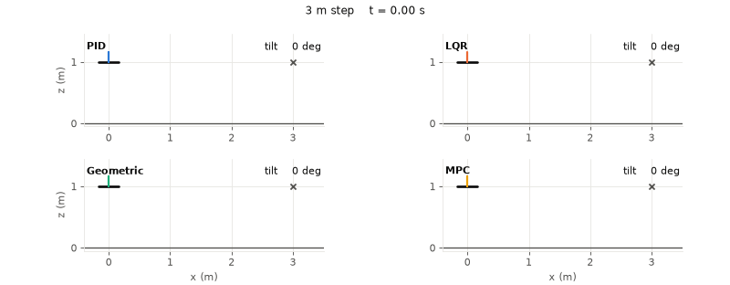
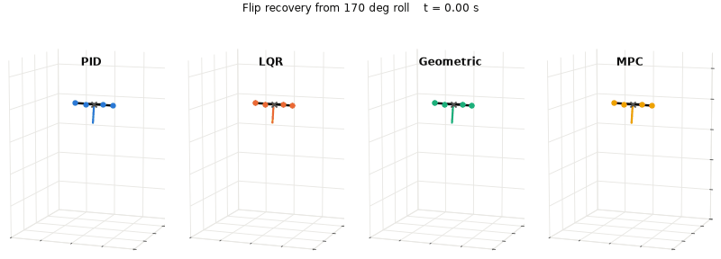
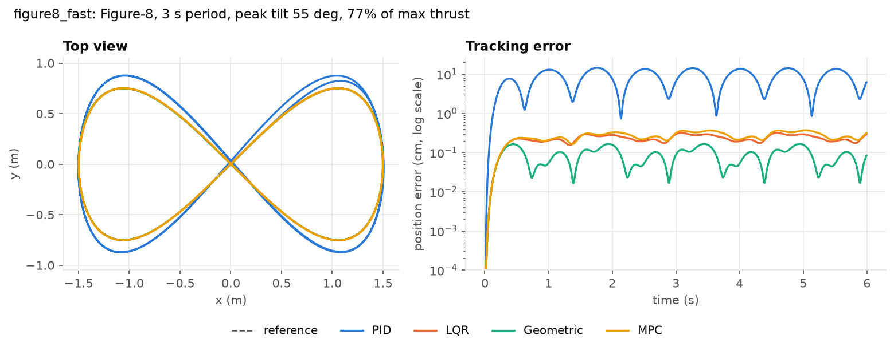

# Quadrotor Control Benchmark: PID vs LQR vs Geometric vs MPC

[](https://github.com/MohnishM21/quadrotor-control-benchmark/actions/workflows/tests.yml)

Four quadrotor controllers, written from scratch, run on one simulator under 11
identical scenarios. The goal is to answer one question with evidence:
**what does each controller's structure buy you, once tuning is held equal?**

<picture>
  <source media="(prefers-color-scheme: dark)" srcset="results/figures/long_step_dark.gif">
  
</picture>

*A 3 m sideways step. LQR's linear model thinks more tilt always means more
acceleration, so it tilts past 150° and falls. The same model inside MPC, with
a 60° tilt constraint, gets there.*

## Findings

1. **Feedforward matters more than feedback structure for tracking.** With
   flatness feedforward, LQR, geometric and MPC all track a 39°-tilt figure-8
   within 0.04 cm RMSE. Cascaded PID, which only feeds forward acceleration,
   lags by 4.33 cm on the same path.
2. **Only integral action fixes a wrong model.** With the real vehicle 30%
   heavier than the model, PID (the only controller with an integrator)
   has 10.2 cm RMSE. The others sag to 19.5 to 22.3 cm. In gusty wind it is
   2.25 cm vs 5.7 to 7.7 cm.
3. **Linear controllers fail outside their linearization.** On the 3 m step,
   LQR crashes. MPC, using the same linear model, survives because it constrains
   tilt to 60°. The geometric controller needs no such limit: it reaches 80°
   and settles in 1.18 s.
4. **"Almost-global" stability does not mean fast recovery.** Starting at 170°
   roll, the geometric controller loses 0.72 m of altitude, about 3 times more
   than the others. Its attitude error is sin(angle), so near upside down it
   produces only about 6% of the restoring torque that a law proportional to the angle would.
5. **MPC's cost is computation, its benefit is constraints.** Without active
   constraints, MPC's first move equals discrete LQR (a test checks this).
   It costs 2.8 ms per step in Python, against 0.7 to 0.8 ms for LQR and geometric.

## Results

Position RMSE in cm (settling time to within 5 cm, for runs that start off the reference).

| Scenario | PID | LQR | Geometric | MPC |
|---|---:|---:|---:|---:|
| `hover_recovery` | 17.74 (1.38 s) | 19.57 (0.97 s) | 19.77 (0.91 s) | 20.28 (1.01 s) |
| `step` | 40.51 (1.30 s) | 43.98 (1.22 s) | 43.17 (1.02 s) | 44.23 (1.25 s) |
| `long_step` | 92.56 (0.81 s) | crash | 92.79 (1.18 s) | 102.01 (1.65 s) |
| `circle` | 0.93 | <0.01 | <0.01 | <0.01 |
| `figure8` | 4.33 | 0.04 | 0.03 | 0.04 |
| `figure8_fast` | 9.29 | 0.23 | 0.10 | 0.27 |
| `flip_recovery` | 8.14 (1.80 s) | 9.48 (1.05 s) | 23.11 (1.39 s) | 8.12 (1.03 s) |
| `mass_mismatch` | 10.16 | 20.85 | 19.51 | 22.32 |
| `motor_lag` | 4.52 | 0.65 | 0.47 | 0.68 |
| `wind` | 2.25 | 7.16 | 5.73 | 7.65 |
| `sensor_noise` | 4.34 | 0.16 | 0.15 | 0.17 |

Full metrics (max error, peak tilt, motor saturation, compute time) are in
[`results/benchmark.csv`](results/benchmark.csv). Each scenario has a figure in
[`results/figures/`](results/figures).

<picture>
  <source media="(prefers-color-scheme: dark)" srcset="results/figures/flip_recovery_dark.gif">
  
</picture>

<picture>
  <source media="(prefers-color-scheme: dark)" srcset="results/figures/figure8_fast_dark.png">
  
</picture>

## The controllers

| | Structure | Model it relies on | Breaks when |
|---|---|---|---|
| **Cascaded PID** | position PID → roll/pitch/thrust → attitude P → rate P | none beyond mass and inertia | tracking fast paths (no attitude-rate feedforward) |
| **LQR** | `u = u_ref − K (x − x_ref)`, K from the continuous Riccati equation | hover linearization (12 states) | large tilt: linear model asks for unbounded tilt |
| **Geometric SE(3)** | Lee, Leok & McClamroch (2010), attitude error on the rotation group | full nonlinear rigid body | almost never; slow near 180° |
| **Linear MPC** | error-state QP, 20 steps × 20 ms, solved by OSQP each control step | hover linearization + rotor and tilt limits | compute budget; linear model at large tilt |

LQR, geometric and MPC use the same reference: full state and torque derived
from position and yaw by differential flatness ([`flatness.py`](src/quadbench/flatness.py)).

## Keeping the comparison fair

- **Same plant, same rates.** RK4 physics at 1 kHz, every controller at 200 Hz.
- **Same actuator limits.** Every controller outputs a body wrench. One shared
  mixer turns it into rotor thrusts and clips them to the motor limits,
  protecting attitude torque first, as flight stacks do.
- **Same aggressiveness.** PID's position loop and the geometric controller
  share natural frequency 4 rad/s and damping ratio 0.85. The attitude loops
  share 25 rad/s and 0.8.
  - LQR's vertical weights are solved in closed form, so its thrust gains equal
    the geometric controller's exactly.
  - LQR's horizontal weights were chosen so a 0.3 m step rises in 0.79 s,
    against 0.74 s for the geometric controller, with no overshoot.
  - Both are checked in [`tests/test_controllers.py`](tests/test_controllers.py).
- **Model mismatch lives only in the plant.** Mass error, motor lag, drag, wind and
  sensor noise are applied to the simulated vehicle. Controllers always design
  with the nominal model.

The vehicle approximates a Crazyflie 2.x (27 g, thrust-to-weight 2.25), using
the cf2x parameters from gym-pybullet-drones.

## What I got wrong first

These changed the conclusions, so they are part of the result.

- **MPC tracked far worse than LQR on the same model.** On the figure-8 its
  error was 5.5 cm against LQR's 0.01 cm. It predicted absolute states,
  which forces the linear model (`a = g·θ`) to reproduce a nonlinear reference
  (`a = g·tan θ`). Rewriting it on the error from the reference fixed this, and
  made "unconstrained MPC = LQR" something a test can check.
- **LQR looked best under model error, but that came from tuning.** My first
  weights gave LQR 5 times the geometric controller's vertical stiffness, so it
  sagged less. After matching the gains, the advantage disappeared. That is why
  the tuning is now checked by tests.
- **PID did not settle after a step.** The integrator wound up during the
  1.5 m transient. Integrating only within 0.25 m of the reference fixed it.

## Scenarios

| Name | Tests |
|---|---|
| `hover_recovery` | 0.6 m offset, 30°/−20° tilt and spinning at start |
| `step` | 1 m step in x and y, 0.5 m in z |
| `long_step` | 3 m step in x: far outside the hover linearization |
| `circle` | r = 1 m, 4 s period |
| `figure8` | 4 s period, 39° peak tilt |
| `figure8_fast` | 3 s period, 55° peak tilt, 77% of maximum thrust |
| `flip_recovery` | start at 170° roll, 3 m altitude |
| `mass_mismatch` | figure-8, vehicle 30% heavier than the model |
| `motor_lag` | figure-8, 30 ms motor time constant, not modelled |
| `wind` | circle with steady wind, gusts and drag |
| `sensor_noise` | figure-8 with noisy position, velocity, attitude and gyro |

## Run it

```bash
git clone https://github.com/MohnishM21/quadrotor-control-benchmark.git
cd quadrotor-control-benchmark
python -m venv .venv
source .venv/bin/activate          # Windows: .venv\Scripts\activate
pip install -e ".[dev]"
pytest                             # 96 tests, about 20 s
python scripts/run_benchmark.py    # all 44 runs + tables + figures, about 2 min
```

Python 3.10 to 3.12. Dependencies: NumPy, SciPy, Matplotlib, OSQP.

## Layout

```
src/quadbench/
├── dynamics.py        rigid body, quaternion attitude, optional motor lag, RK4
├── params.py          vehicle parameters and X-configuration mixer
├── trajectories.py    hover, step, circle, figure-8 with exact derivatives to snap
├── flatness.py        full reference state and torque from position + yaw
├── linear_model.py    hover linearization and exact discretization
├── controllers/       pid.py, lqr.py, geometric.py, mpc.py
├── simulator.py       closed loop, shared mixer, sensor noise, crash detection
├── scenarios.py       the 11 benchmark scenarios
├── metrics.py         RMSE, settling time, peak tilt
└── plotting.py        light and dark figures and GIFs
tests/                 physics, flatness, controller and tuning checks
scripts/run_benchmark.py
```

## Limitations and next steps

- Controllers get the true state (plus noise in one scenario). There is no state estimator yet.
- Compute times are single-threaded Python. Only the ratios between controllers mean anything.
- The plant has no blade flapping, ground effect or battery sag.
- MPC and LQR use one hover linearization. Re-linearizing along the reference
  (time-varying MPC) should close most of the gap to the geometric controller at large tilt.
- Next: add integral action to the geometric controller, and compare against a
  reinforcement-learning policy trained on this simulator.

## References

- T. Lee, M. Leok, N. H. McClamroch, *Geometric tracking control of a quadrotor UAV on SE(3)*, IEEE CDC 2010.
- D. Mellinger, V. Kumar, *Minimum snap trajectory generation and control for quadrotors*, IEEE ICRA 2011.
- B. Stellato et al., *OSQP: an operator splitting solver for quadratic programs*, Mathematical Programming Computation, 2020.
- J. Panerati et al., *Learning to fly: a Gym environment with PyBullet physics for reinforcement learning of multi-agent quadcopter control*, IROS 2021.

## License

MIT
